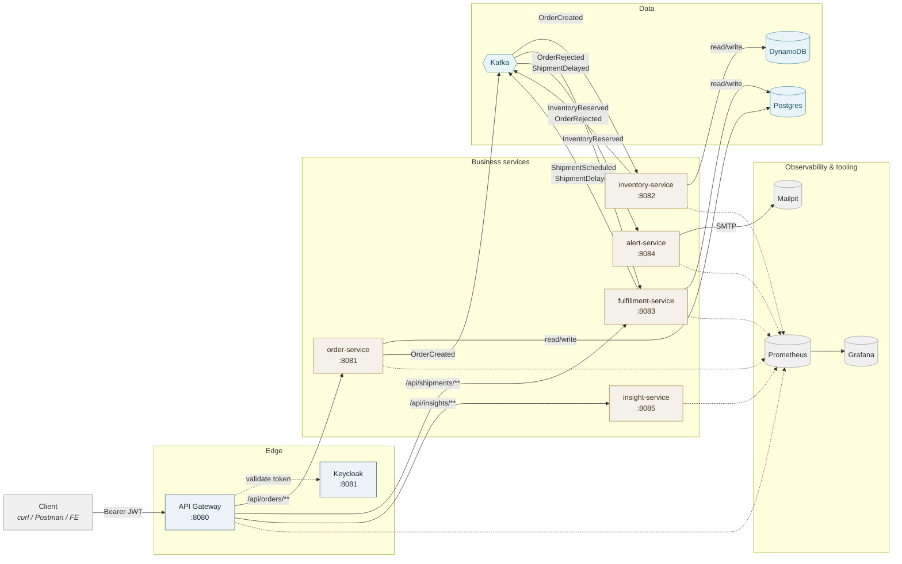
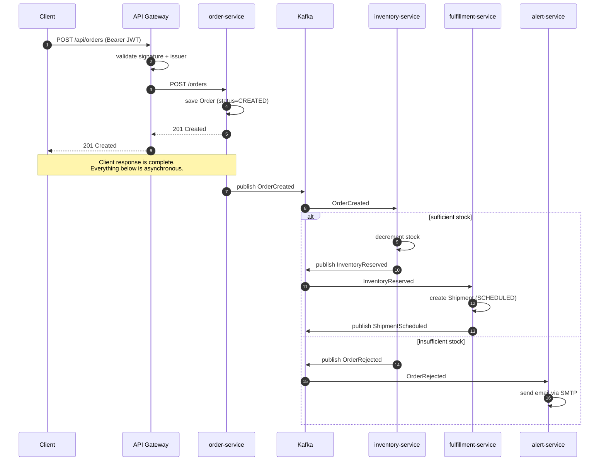

# Order Fulfillment & Inventory System

A five-service event-driven microservices system built to explore the patterns that show up repeatedly in production cloud architecture: distributed data ownership, asynchronous event choreography, polyglot persistence, resilience at the edge, and observability as a primary concern.

---

## What it does

A retailer accepts orders through a single HTTP endpoint. Behind that endpoint, a chain of independent services handles the order: reserving stock, scheduling a shipment, and alerting operations when something goes wrong.

Two Paths:

- **Happy path:** an order is created, stock is reserved, and a shipment is scheduled, each step published as an event the next service consumes.
- **Rejection path:** an order is placed for a SKU with insufficient stock. The order still succeeds (201 Created), but a rejection event fires, and ops receives an email within seconds.

The system is compact enough to reason about end-to-end, and is architected the way a real distributed system would be at this shape.

---

## Architecture



Five business services and one gateway, connected two ways:

- **Synchronously** — client → gateway → backend, with the gateway doing auth, routing, and circuit breaking.
- **Asynchronously** — services publish and consume events through Kafka. No service knows about another service's URL or existence.

The gateway is the only component a caller ever addresses directly.

---

## Services

| Service | Owns | Datastore | Kafka role |
|---|---|---|---|
| **api-gateway** (`:8080`) | Routing, OAuth2 token validation, per-route circuit breakers, OpenAPI aggregation | — | — |
| **order-service** (`:8081`) | Order intake and status | Postgres | Producer — `OrderCreated` |
| **inventory-service** (`:8082`) | Stock per SKU | DynamoDB | Consumer + Producer — reads `OrderCreated`, emits `InventoryReserved` / `OrderRejected` |
| **fulfillment-service** (`:8083`) | Shipment lifecycle (`SCHEDULED → SHIPPED → DELIVERED`, `DELAYED` as a branch) | Postgres | Consumer + Producer — reads `InventoryReserved`, emits `ShipmentScheduled` / `ShipmentDelayed` |
| **alert-service** (`:8084`) | Turning bad-news events into an email | — | Consumer — reads `OrderRejected`, `ShipmentDelayed` |
| **insight-service** (`:8085`) | Natural-language summaries over order and fulfillment data | — | REST only |

Each service owns exactly one datastore and one Kafka responsibility. No service reads another service's tables. Where two services share infrastructure (Order and Fulfillment share a Postgres instance), they use separate tables and treat each other's schemas as opaque.

---

## How a request flows



Important detail: **the client's HTTP request completes the moment the order row is saved.** Everything downstream — inventory checks, shipment creation, alerting — happens after the response has gone back.

This is the whole reason to choose events over a synchronous call chain. If Inventory Service is down, order intake still works. Events sit in the topic until Inventory catches up. In a synchronous `Order → Inventory → Fulfillment` chain, Order Service's uptime would be limited by the *worst* of the three.

---

## Event contracts

Five topics, each with exactly one producer:

| Topic | Producer | Consumer |
|---|---|---|
| `order-created` | order-service | inventory-service |
| `inventory-reserved` | inventory-service | fulfillment-service |
| `order-rejected` | inventory-service | alert-service |
| `shipment-scheduled` | fulfillment-service | *(available for a future tracking UI)* |
| `shipment-delayed` | fulfillment-service | alert-service |

**One producer per topic is the rule.** It's what makes ownership unambiguous. If two services could both publish `OrderRejected`, there would need to be a rule for which one wins. With a single producer, there's nothing to arbitrate.

All five event shapes live in a shared `common-events` Maven module so producer and consumer can never drift on schema.

---

## Tech stack

| Layer | Choice |
|---|---|
| Language | Java 21 |
| Framework | Spring Boot 3.3.4, Spring Cloud 2023.0.3 |
| Build | Maven multi-module |
| Event bus | Apache Kafka (KRaft mode, no Zookeeper) |
| Relational data | PostgreSQL 16 |
| Key-value data | DynamoDB (Local for dev, real for AWS) |
| Auth | Keycloak (OIDC / OAuth2, JWT-based) |
| Resilience | Resilience4j circuit breakers at the gateway |
| Observability | Spring Boot Actuator + Micrometer + Prometheus + Grafana |
| Local email | Mailpit (SMTP + web UI) |
| Local orchestration | Docker Compose |
| Testing | JUnit 5, Testcontainers, `spring-kafka-test` embedded broker |

---

## Running locally

**Prerequisites:** Docker Desktop

```bash
# Copy environment template
cp .env.example .env

# Bring up the full stack (13 containers)
docker compose up -d

# Confirm everything is healthy
docker compose ps
```

**Services after startup:**

| URL | Purpose |
|---|---|
| `http://localhost:8080` | API Gateway (single entry point) |
| `http://localhost:8081` | Keycloak admin console |
| `http://localhost:3000` | Grafana |
| `http://localhost:8025` | Mailpit (view sent emails) |
| `http://localhost:9090` | Prometheus |

**Get a token and create an order:**

```bash
TOKEN=$(curl -s -X POST http://localhost:8081/realms/fulfillment/protocol/openid-connect/token \
  -H "Content-Type: application/x-www-form-urlencoded" \
  -d "grant_type=password&client_id=gateway-client&client_secret=local-dev-secret&username=dev-user&password=devpassword" \
  | python3 -c "import sys,json; print(json.load(sys.stdin)['access_token'])")

curl -X POST http://localhost:8080/api/orders \
  -H "Authorization: Bearer $TOKEN" \
  -H "Content-Type: application/json" \
  -d '{"customerId":"cust-1","items":[{"sku":"sku-1","quantity":2}]}'
```
---

## Testing

Per-service, not exhaustive:

- A context-load `@SpringBootTest` per service.
- One Testcontainers-backed integration test per service, against its real datastore.
- Producer/consumer tests for Kafka-connected services using `spring-kafka-test`'s embedded broker.

```bash
# Run all tests
mvn test

# Run tests for one service
mvn -pl inventory-service -am test
```

---

## Project structure

```
order-fulfillment-system/
├── pom.xml                          # parent POM, dependency management
├── docker-compose.yml               # 13 containers: 6 services + 7 infra
├── .env.example                     # placeholders only
│
├── common-events/                   # shared Kafka event contracts
├── order-service/
├── inventory-service/
├── fulfillment-service/
├── alert-service/
├── insight-service/
├── api-gateway/
│
├── infra/
│   ├── keycloak/realm-export.json
│   ├── prometheus/prometheus.yml
│   └── grafana/
│       ├── provisioning/
│       └── dashboards/
│
└── docs/
    ├── smoke-test.md                # end-to-end verification runbook
```

---

## License

MIT. This project exists to be read, learned from, and borrowed from.